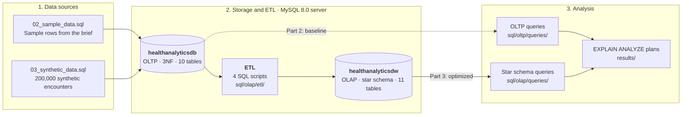
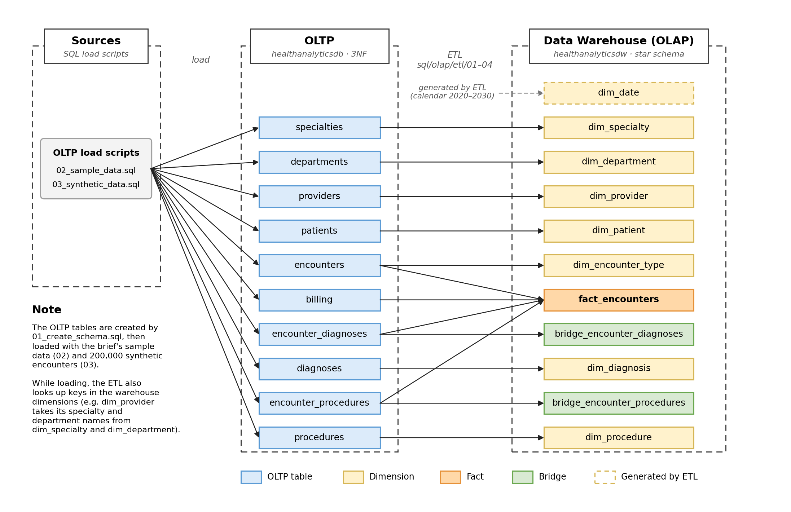
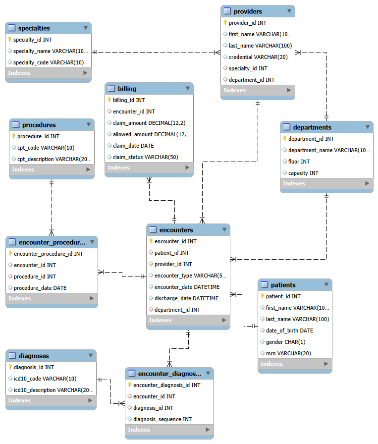
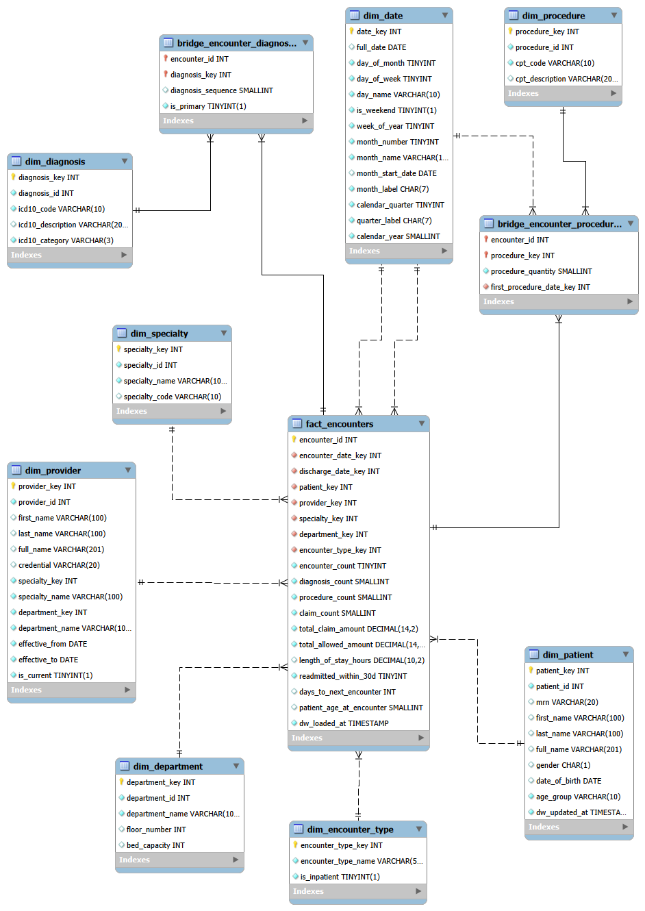

# Healthcare Analytics Lab: OLTP to Star Schema

A data engineering mini project. A normalized (3NF) clinical database is analyzed for slow analytical queries, then redesigned as a star schema optimized for those queries. See the full brief in [Instructions.md](Instructions.md).

The repository uses two names for the two sides of the project:

- **OLTP**: the normalized transactional database `healthanalyticsdb` (Part 1 and Part 2).
- **OLAP**: the star schema data warehouse `healthanalyticsdw` (Part 3), built for analytical queries.

## Contents

- [Deliverables](#deliverables)
- [Results Summary](#results-summary)
- [Architecture](#architecture)
- [Data Flow](#data-flow)
- [Data Models](#data-models)
- [Getting Started](#getting-started)
- [Repository Structure](#repository-structure)
- [Notes](#notes)

## Deliverables

| Part | Deliverable | Status |
| ---- | ----------- | ------ |
| 2 | [query_analysis.txt](query_analysis.txt): 4 OLTP queries with performance analysis | Done |
| 3.1 | [design_decisions.txt](design_decisions.txt): star schema design choices | Done |
| 3.2 | [star_schema.sql](star_schema.sql): star schema DDL | Done |
| 3.3 | [star_schema_queries.txt](star_schema_queries.txt): optimized queries with performance comparison | Done |
| 3.4 | [etl_design.txt](etl_design.txt): ETL pseudocode / narrative | Done |
| 4 | [reflection.md](reflection.md): analysis and reflection | Done |

## Results Summary

Measured on 200,004 synthetic encounters with a single `EXPLAIN ANALYZE` run per query. Every star query returns exactly the same rows as its OLTP version.

| Question | OLTP | Star schema | Speedup | Rows read: OLTP → Star |
| -------- | ---- | ----------- | ------- | ---------------------- |
| Q1 Monthly encounters by specialty | 2,910 ms | 219 ms | 13.3x | 600,012 → 201,352 |
| Q2 Top diagnosis-procedure pairs | 12,757 ms | 1,858 ms | 6.9x | 1,799,001 → 1,047,931 |
| Q3 30-day readmission rate | 2,672 ms | 19.3 ms | 138x | 626,446 → 32,451 |
| Q4 Revenue by specialty & month | 2,798 ms | 164 ms | 17.1x | 759,528 → 200,255 |

See [query_analysis.txt](query_analysis.txt) for the OLTP bottlenecks and [star_schema_queries.txt](star_schema_queries.txt) for why each star query is faster.

## Architecture



The project has three layers, all running on one local MySQL 8.0 server:

1. **Data sources.** The brief's sample data, plus 200,000 synthetic encounters generated so performance can be measured at a realistic volume.
2. **Storage and ETL.** The normalized OLTP database holds the source data. Four ETL scripts copy and reshape it into a separate star schema data warehouse. The two databases never share tables: the warehouse is rebuilt from the OLTP data, never the other way around.
3. **Analysis.** The same four business questions are run against both databases. Their `EXPLAIN ANALYZE` plans, saved in `results/`, provide the before-and-after performance comparison.

> The architecture diagram is written in [Mermaid](https://mermaid.js.org/), which GitHub renders automatically. To see it in VS Code's Markdown preview, install the *Markdown Preview Mermaid Support* extension.

## Data Flow



The diagram traces every table through the project, from left to right:

1. **Sources → OLTP.** Two SQL scripts load the brief's sample data and 200,000 synthetic encounters into the 10 normalized tables.
2. **OLTP → Data Warehouse.** The four ETL scripts reshape the data. Most OLTP tables map one-to-one to a dimension. `fact_encounters` combines four tables: each encounter, its billing (summed) and its diagnoses and procedures (counted). The two junction tables also feed the bridge tables.
3. **`dim_date` is the exception.** It isn't copied from anywhere: the ETL generates one row per day from 2020 to 2030.

## Data Models

### OLTP Schema (healthanalyticsdb)



### Star Schema (healthanalyticsdw)



## Getting Started

### Tech Stack

- **Database:** MySQL 8.0.18 or later (required for `EXPLAIN ANALYZE`)
- **Client:** MySQL Workbench

### Setup

Run each script in MySQL Workbench (open it, then click the lightning-bolt icon to run the whole file). Every script is re-runnable.

Before loading the synthetic data, raise Workbench's query timeout: **Edit → Preferences → SQL Editor → "DBMS connection read timeout interval"** to `600`, then reconnect. The default of 30 seconds is too short for the larger scripts and causes *"Error Code: 2013. Lost connection to MySQL server during query"*.

**OLTP database (`healthanalyticsdb`)**

1. `sql/oltp/01_create_schema.sql`: creates the database and its 10 tables.
2. `sql/oltp/02_sample_data.sql`: loads the brief's sample data. The row-count check should return 3, 3, 3, 3, 3, 3, 4, 6, 4, 2.
3. `sql/oltp/03_synthetic_data.sql`: adds 200,000 deterministic synthetic encounters on top of the sample data, so query performance can be measured at a realistic volume.

**Star schema data warehouse (`healthanalyticsdw`)**

4. `star_schema.sql`: creates the warehouse database and its 11 tables.
5. `sql/olap/etl/01_load_dim_date.sql` to `sql/olap/etl/04_load_bridges.sql`, in order: load the dimensions, fact table and bridge tables from the OLTP database.

**Queries**

6. `sql/oltp/queries/` and `sql/olap/queries/`: the 4 business questions in each schema. Each file contains the query, followed by an `EXPLAIN ANALYZE` of the same query. The saved plans are in `results/`.

## Repository Structure

```text
Healthcare-Analytics-Lab/
├── README.md
├── Instructions.md                  # Project brief
├── .gitignore
│
├── query_analysis.txt               # Part 2 deliverable
├── design_decisions.txt             # Part 3.1 deliverable
├── star_schema.sql                  # Part 3.2 deliverable (warehouse DDL)
├── star_schema_queries.txt          # Part 3.3 deliverable
├── etl_design.txt                   # Part 3.4 deliverable
├── reflection.md                    # Part 4 deliverable
│
├── sql/
│   ├── data_flow_diagram.png        # Table-level data flow (OLTP -> warehouse)
│   ├── oltp/                        # Normalized database (healthanalyticsdb)
│   │   ├── 01_create_schema.sql     # 3NF schema (10 tables)
│   │   ├── 02_sample_data.sql       # Sample data from the brief
│   │   ├── 03_synthetic_data.sql    # 200k deterministic encounters
│   │   ├── erd_diagram.png          # ERD of the OLTP schema
│   │   └── queries/                 # The 4 questions on the OLTP schema
│   │       ├── q1_monthly_encounters.sql
│   │       ├── q2_diagnosis_procedure_pairs.sql
│   │       ├── q3_readmission_rate.sql
│   │       └── q4_revenue_by_specialty.sql
│   └── olap/                        # Star schema data warehouse (healthanalyticsdw)
│       ├── etl/                     # OLTP -> star schema load, run in order
│       │   ├── 01_load_dim_date.sql
│       │   ├── 02_load_dimensions.sql
│       │   ├── 03_load_fact_encounters.sql
│       │   └── 04_load_bridges.sql
│       ├── queries/                 # The 4 questions on the star schema
│       │   ├── q1_monthly_encounters.sql
│       │   ├── q2_diagnosis_procedure_pairs.sql
│       │   ├── q3_readmission_rate.sql
│       │   └── q4_revenue_by_specialty.sql
│       └── olap_erd_diagram.png     # ERD of the star schema
│
└── results/                         # Saved EXPLAIN ANALYZE output
    ├── oltp_explain_analyze/
    │   └── oltp_q1.txt ... oltp_q4.txt
    └── olap_explain_analyze/
        └── olap_q1.txt ... olap_q4.txt
```

## Notes

- The brief describes "8 normalized tables", but its DDL defines 10: 7 entity and lookup tables (`patients`, `providers`, `specialties`, `departments`, `encounters`, `diagnoses`, `procedures`), 2 junction tables (`encounter_diagnoses`, `encounter_procedures`), and `billing`. This project uses the DDL as written.
- The sample data's original insert order loads `billing` before `encounters`, which violates `billing`'s foreign key. `02_sample_data.sql` loads tables parents-first.
- The synthetic data is generated from hashes of row numbers, not `RAND()`, so every machine gets identical data and identical row counts in the query plans. Absolute timings depend on the machine; the speedup factors and row counts are the meaningful comparison.